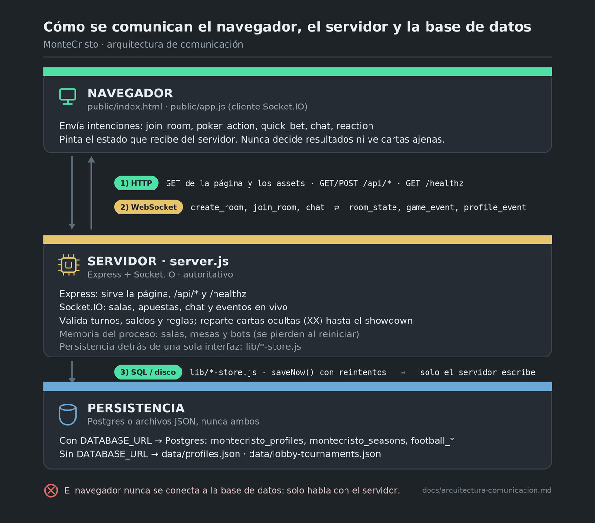
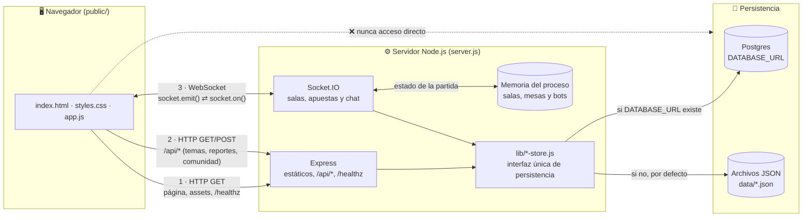
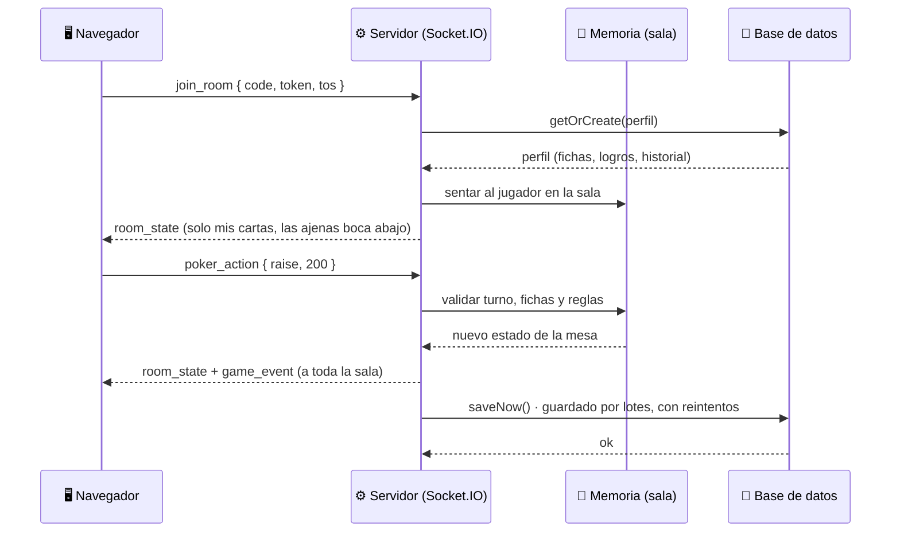

# Cómo se comunican el navegador, el servidor y la base de datos

Diagrama de referencia de la comunicación entre las tres capas de MonteCristo:
el **navegador** (`public/`), el **servidor** (`server.js` + `lib/`) y la
**persistencia** (Postgres o archivos JSON).

Regla de oro: **el navegador nunca habla con la base de datos**. Solo habla con el
servidor, por dos canales (HTTP y WebSocket), y el servidor es el único que lee y
escribe en la base de datos.

## Diagrama general



La imagen se dibuja con `scripts/diagramas/comunicacion.py` (Pillow). Abajo queda
el mismo esquema como **código Mermaid**, para poder editarlo sin salir del
repositorio; GitHub lo renderiza automáticamente:



### El mismo diagrama en texto

```text
┌────────────────────────────────────────────────────────────────────┐
│ 🖥️  NAVEGADOR · public/index.html + public/app.js                  │
│ Envía intenciones y pinta el estado. Nunca decide resultados.      │
└────────────────────────────────────────────────────────────────────┘
          │  1) HTTP ⇄  GET página y assets · GET/POST /api/* · /healthz
          │  2) WebSocket ⇄  create_room · join_room · poker_action · chat
          ▼
┌────────────────────────────────────────────────────────────────────┐
│ ⚙️  SERVIDOR · server.js (Express + Socket.IO)                     │
│ Valida turnos, saldos y reglas: es autoritativo.                   │
│ Responde room_state, lobby_state, game_event, profile_event.       │
│ Estado en memoria: salas, mesas y bots.                            │
└────────────────────────────────────────────────────────────────────┘
          │  3) SQL o escritura en disco · lib/*-store.js (solo el servidor)
          ▼
┌────────────────────────────────────────────────────────────────────┐
│ 💾  PERSISTENCIA                                                   │
│ Postgres si existe DATABASE_URL: montecristo_*, football_*.        │
│ Si no: data/profiles.json y data/lobby-tournaments.json.           │
└────────────────────────────────────────────────────────────────────┘

  El navegador nunca se conecta a la base de datos: solo habla con el servidor.
```

## Secuencia de una jugada

Ejemplo con una mano de póker: cómo fluye un `poker_action` hasta que la base de
datos queda actualizada y la sala entera ve el resultado.



## Qué viaja por cada canal

| Canal | Dirección | Se usa para | Ejemplos reales del repo |
|---|---|---|---|
| **HTTP `GET`** | navegador ← servidor | Página, estilos, scripts e imágenes locales; consultas puntuales | `public/index.html`, `/assets`, `GET /healthz`, `GET /api/seasonal-theme`, `GET /api/perfil/:token/historial` |
| **HTTP `GET/POST`** | navegador → servidor | Operaciones que no necesitan tiempo real | `GET/POST /api/social/v1/*` (comunidad), `POST /api/reports`, `GET/POST /api/estadio/*` |
| **WebSocket (Socket.IO)** | ambos sentidos | Todo lo que debe sentirse al instante y con estado compartido | `create_room`, `join_room`, `poker_action`, `quick_bet`, `chat`, `reaction` del cliente; `lobby_state`, `room_state`, `game_event`, `profile_event`, `social_event` del servidor |
| **SQL / escritura en disco** | servidor → persistencia | Guardar perfiles, temporadas, comunidad y apuestas | `lib/profile-store-pg.js` → tablas `montecristo_profiles`, `montecristo_seasons`, `football_*`; `lib/profile-store.js` → `data/profiles.json` |

## Notas que conviene recordar

1. **El servidor es autoritativo.** El navegador envía intenciones («subo 200»,
   «apuesto al rojo»); el servidor valida turno, saldo y reglas, y reparte cartas
   ocultas (`XX`) hasta el showdown. Ningún resultado se decide en el cliente.
2. **Dos backends, una sola interfaz.** `lib/*-store-factory.js` elige el backend
   al arrancar: con `DATABASE_URL` se usa Postgres (recomendado en Render + Neon);
   sin ella, los archivos JSON de `data/`. `server.js` no sabe cuál está activo.
3. **No todo está en la base de datos.** Las salas, las mesas y los bots viven en
   la memoria del proceso (`MEM` en el diagrama): si el servidor se reinicia, las
   partidas en curso se pierden, aunque los perfiles y saldos sí se conservan.
4. **Cuándo se escribe.** Los cambios de perfil se acumulan en memoria y se
   escriben con `saveNow()`: al apagar el servidor (`SIGTERM` de cada deploy), al
   pagar premios de torneo y en los cierres de temporada. Si Postgres no responde,
   el guardado se reintenta en segundo plano en vez de descartarse.
5. **Un solo canal expuesto al exterior.** Si se despliegan varias instancias,
   todas deben compartir la misma base de datos y agregar el adaptador de
   Socket.IO para Redis; el navegador seguiría hablando con un único origen.
