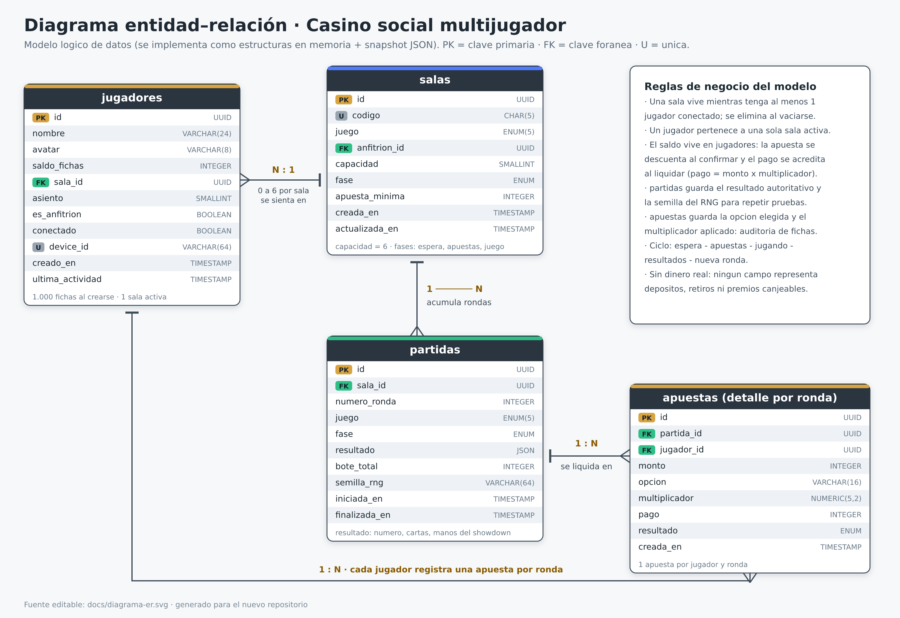

# Ticket 03 · Modelo de datos (diagrama entidad–relación)

| Campo | Valor |
| --- | --- |
| **ID** | DOC-03 |
| **Tipo** | Diseño de datos |
| **Estado** | Propuesta · listo para implementar |
| **Prioridad** | Alta |
| **Depende de** | DOC-01 (alcance), DOC-02 (reglas y pagos) |
| **Desbloquea** | Estructuras en memoria, eventos de Socket.IO, snapshot JSON |
| **Imagen** | `docs/diagrama-er.png` (fuente editable: `docs/diagrama-er.svg`) |

> La v1 **no usa base de datos**: el estado vive en memoria del servidor y opcionalmente se guarda
> en un archivo JSON. El modelo se documenta igual que un esquema relacional para que migrar a
> PostgreSQL después sea un cambio de almacenamiento, no un rediseño.

---

## 1. Diagrama



---

## 2. Entidades y campos

### `jugadores`

Un registro por persona conectada (o que estuvo en la sala durante la sesión).

| Campo | Tipo | Clave | Descripción | Ejemplo |
| --- | --- | --- | --- | --- |
| `id` | UUID / string | **PK** | Identificador único del jugador | `p_7f3a91` |
| `nombre` | VARCHAR(24) | | Nombre visible en la sala | `Ana` |
| `avatar` | VARCHAR(8) | | Emoji o clave del avatar elegido | `🦊` |
| `saldo_fichas` | INTEGER | | Fichas virtuales disponibles; inicia en 1000 | `1000` |
| `sala_id` | UUID | **FK** → `salas.id` | Sala en la que está sentado (null si no está en ninguna) | `s_K7Q2M` |
| `asiento` | SMALLINT | | Lugar en la mesa, de 1 a 6 | `3` |
| `es_anfitrion` | BOOLEAN | | `true` si es quien creó la sala | `false` |
| `conectado` | BOOLEAN | | `false` si se desconectó y está en periodo de reconexión | `true` |
| `device_id` | VARCHAR(64) | **U** | Identificador del navegador; permite recuperar el saldo | `d_9c2b…` |
| `creado_en` | TIMESTAMP | | Primera vez que entró | `2026-10-14T20:10:00Z` |
| `ultima_actividad` | TIMESTAMP | | Último evento recibido | `2026-10-14T20:42:11Z` |

### `salas`

Una sala por mesa activa. Se crea al pedirla y se elimina cuando queda vacía.

| Campo | Tipo | Clave | Descripción | Ejemplo |
| --- | --- | --- | --- | --- |
| `id` | UUID | **PK** | Identificador interno | `s_K7Q2M` |
| `codigo` | CHAR(5) | **U** | Código compartible, 5 caracteres en mayúsculas | `K7Q2M` |
| `juego` | ENUM | | `coinflip` · `dice` · `roulette` · `blackjack` · `poker` | `roulette` |
| `anfitrion_id` | UUID | **FK** → `jugadores.id` | Quién creó la sala | `p_7f3a91` |
| `capacidad` | SMALLINT | | Máximo de jugadores: **6** | `6` |
| `fase` | ENUM | | `espera` · `apuestas` · `jugando` · `resultados` | `apuestas` |
| `apuesta_minima` | INTEGER | | Mínimo permitido en la sala: **10** | `10` |
| `creada_en` | TIMESTAMP | | Cuándo se creó | `2026-10-14T20:10:00Z` |
| `actualizada_en` | TIMESTAMP | | Último cambio de estado | `2026-10-14T20:42:11Z` |

### `partidas`

Una fila por **ronda** jugada. Es el registro histórico y la fuente del resultado autoritativo.

| Campo | Tipo | Clave | Descripción | Ejemplo |
| --- | --- | --- | --- | --- |
| `id` | UUID | **PK** | Identificador de la ronda | `r_0042` |
| `sala_id` | UUID | **FK** → `salas.id` | Sala a la que pertenece | `s_K7Q2M` |
| `numero_ronda` | INTEGER | | Consecutivo dentro de la sala, empieza en 1 | `7` |
| `juego` | ENUM | | Copia del juego (la sala no cambia de juego) | `roulette` |
| `fase` | ENUM | | `apuestas` · `jugando` · `resultados` | `resultados` |
| `resultado` | JSON | | Resultado autoritativo: número, cartas o manos del showdown | `{"numero":17,"color":"negro"}` |
| `bote_total` | INTEGER | | Suma apostada en la ronda (o bote en póker) | `450` |
| `semilla_rng` | VARCHAR(64) | | Semilla aleatoria usada; permite repetir la ronda en pruebas | `sd_1f9a…` |
| `iniciada_en` | TIMESTAMP | | Cuándo arrancó | `2026-10-14T20:41:00Z` |
| `finalizada_en` | TIMESTAMP | | Cuándo se liquidó | `2026-10-14T20:41:35Z` |

### `apuestas`

Una fila por jugador y ronda. Es el detalle que permite auditar cada ficha.

| Campo | Tipo | Clave | Descripción | Ejemplo |
| --- | --- | --- | --- | --- |
| `id` | UUID | **PK** | Identificador de la apuesta | `b_0913` |
| `partida_id` | UUID | **FK** → `partidas.id` | Ronda a la que pertenece | `r_0042` |
| `jugador_id` | UUID | **FK** → `jugadores.id` | Quién apostó | `p_7f3a91` |
| `monto` | INTEGER | | Fichas apostadas (mínimo 10) | `100` |
| `opcion` | VARCHAR(16) | | Opción elegida: `cara`, `alto`, `n:17`, `rojo`, … | `n:17` |
| `multiplicador` | NUMERIC(5,2) | | Multiplicador aplicado (tabla de DOC-02) | `36.00` |
| `pago` | INTEGER | | Fichas acreditadas al liquidar | `3600` |
| `resultado` | ENUM | | `gana` · `pierde` · `empate` | `gana` |
| `creada_en` | TIMESTAMP | | Cuándo se confirmó | `2026-10-14T20:41:10Z` |

---

## 3. Relaciones y cardinalidad

| Desde | Hasta | Cardinalidad | Significado |
| --- | --- | --- | --- |
| `salas` | `jugadores` | 1 ── N (**0 a 6**) | Una sala tiene entre 0 y 6 jugadores sentados |
| `salas` | `partidas` | 1 ── N | Una sala acumula tantas rondas como se jueguen |
| `partidas` | `apuestas` | 1 ── N | Cada ronda tiene una apuesta por jugador participante |
| `jugadores` | `apuestas` | 1 ── N | Cada jugador registra una apuesta por ronda |

Reglas que el diagrama no dibuja pero el código debe cumplir:

- Un `jugador` pertenece a **una sola sala activa** (`sala_id` único en la práctica).
- `asiento` es único dentro de la sala (1…6).
- `codigo` es único entre salas activas.
- Solo puede haber **una apuesta por `jugador_id` + `partida_id`**.

---

## 4. Implementación en memoria (v1)

```js
// Estructuras del servidor (Map = tabla)
const salas     = new Map(); // id  -> sala
const jugadores = new Map(); // id  -> jugador
const partidas  = new Map(); // id  -> partida   (se poda a las últimas 20 por sala)
const apuestas  = new Map(); // id  -> apuesta

// Una sala en memoria se ve así:
{
  id: 's_K7Q2M',
  codigo: 'K7Q2M',
  juego: 'roulette',
  anfitrionId: 'p_7f3a91',
  capacidad: 6,
  fase: 'apuestas',
  apuestaMinima: 10,
  jugadores: ['p_7f3a91', 'p_2b8c04'], // hasta 6 ids, en orden de asiento
  rondaActual: 'r_0042',
  creadaEn: 1760475000000,
  actualizadaEn: 1760476931000
}
```

- **Sin base de datos:** no hay que instalar ni configurar nada; el estado se pierde al reiniciar
  salvo que se guarde el snapshot.
- **Snapshot opcional:** `data/estado.json` escrito al apagar (y cada 5 minutos) con el contenido
  de los cuatro `Map`. Al arrancar, si el archivo existe, se carga.
- **Migración futura a PostgreSQL:** crear las cuatro tablas con el DDL de la sección 5 y cambiar
  los `Map` por consultas. Ni las reglas ni los eventos cambian.

---

## 5. DDL de referencia (para cuando se use PostgreSQL)

```sql
CREATE TABLE jugadores (
  id                TEXT PRIMARY KEY,
  nombre            VARCHAR(24) NOT NULL,
  avatar            VARCHAR(8)  NOT NULL DEFAULT '🙂',
  saldo_fichas      INTEGER     NOT NULL DEFAULT 1000 CHECK (saldo_fichas >= 0),
  sala_id           TEXT        REFERENCES salas(id) ON DELETE SET NULL,
  asiento           SMALLINT    CHECK (asiento BETWEEN 1 AND 6),
  es_anfitrion      BOOLEAN     NOT NULL DEFAULT FALSE,
  conectado         BOOLEAN     NOT NULL DEFAULT TRUE,
  device_id         VARCHAR(64) UNIQUE,
  creado_en         TIMESTAMPTZ NOT NULL DEFAULT now(),
  ultima_actividad  TIMESTAMPTZ NOT NULL DEFAULT now()
);

CREATE TABLE salas (
  id              TEXT PRIMARY KEY,
  codigo          CHAR(5)    UNIQUE NOT NULL,
  juego           TEXT       NOT NULL CHECK (juego IN ('coinflip','dice','roulette','blackjack','poker')),
  anfitrion_id    TEXT       REFERENCES jugadores(id),
  capacidad       SMALLINT   NOT NULL DEFAULT 6 CHECK (capacidad BETWEEN 1 AND 6),
  fase            TEXT       NOT NULL DEFAULT 'espera',
  apuesta_minima  INTEGER    NOT NULL DEFAULT 10,
  creada_en       TIMESTAMPTZ NOT NULL DEFAULT now(),
  actualizada_en  TIMESTAMPTZ NOT NULL DEFAULT now()
);

CREATE TABLE partidas (
  id             TEXT PRIMARY KEY,
  sala_id        TEXT REFERENCES salas(id) ON DELETE CASCADE,
  numero_ronda   INTEGER NOT NULL,
  juego          TEXT    NOT NULL,
  fase           TEXT    NOT NULL,
  resultado      JSONB,
  bote_total     INTEGER NOT NULL DEFAULT 0,
  semilla_rng    VARCHAR(64),
  iniciada_en    TIMESTAMPTZ NOT NULL DEFAULT now(),
  finalizada_en  TIMESTAMPTZ,
  UNIQUE (sala_id, numero_ronda)
);

CREATE TABLE apuestas (
  id             TEXT PRIMARY KEY,
  partida_id     TEXT REFERENCES partidas(id) ON DELETE CASCADE,
  jugador_id     TEXT REFERENCES jugadores(id) ON DELETE CASCADE,
  monto          INTEGER       NOT NULL CHECK (monto >= 10),
  opcion         VARCHAR(16)   NOT NULL,
  multiplicador  NUMERIC(5,2)  NOT NULL DEFAULT 0,
  pago           INTEGER       NOT NULL DEFAULT 0,
  resultado      TEXT          CHECK (resultado IN ('gana','pierde','empate')),
  creada_en      TIMESTAMPTZ   NOT NULL DEFAULT now(),
  UNIQUE (partida_id, jugador_id)
);
```

---

## 6. Criterios de aceptación

- [ ] Existen las cuatro entidades con los campos y tipos de este documento.
- [ ] La relación `salas → jugadores` respeta el máximo de **6** y rechaza el séptimo ingreso.
- [ ] Cada ronda crea **una** fila en `partidas` y **una** en `apuestas` por jugador que apostó.
- [ ] `multiplicador` y `pago` se guardan en la apuesta y coinciden con `02-reglas-y-pagos.md`.
- [ ] Al salir un jugador sin lanzar la ronda, su apuesta desaparece y su saldo vuelve al valor previo.
- [ ] El snapshot JSON (si está activo) recrea salas, jugadores y saldos al reiniciar.
- [ ] El DDL de la sección 5 se ejecuta sin errores si en el futuro se activa PostgreSQL.
